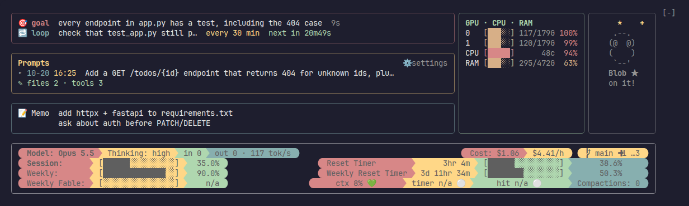
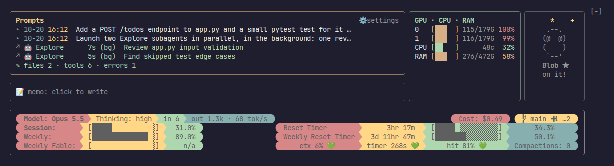
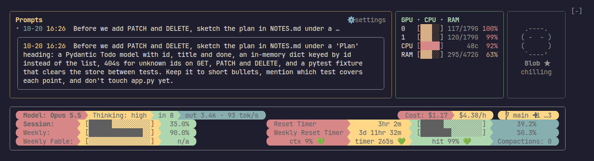
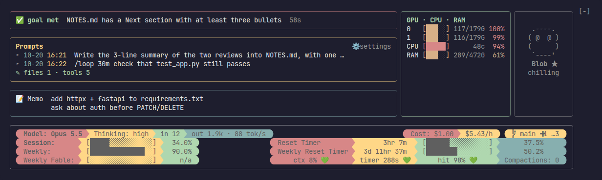
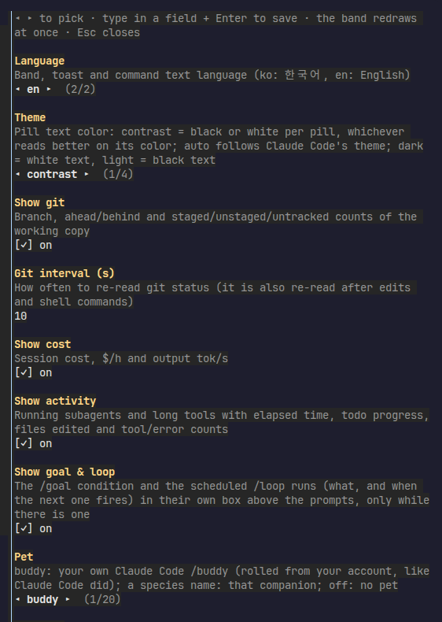

# status-band

A clickable status band for Claude Code. It sits right above the prompt and shows what you usually have to go looking for: how much of your usage limit is left, what this session costs, what Claude is doing right now, your `/goal` and `/loop`, your recent prompts, GPU/CPU/RAM, a scratch memo, and your old `/buddy`.



> Unofficial. Not affiliated with or endorsed by Anthropic. It only displays things; it never changes your prompts, Claude's tools or the system prompt.

## What it shows

| Part | What you get |
| --- | --- |
| **Usage** | 5-hour session, weekly and weekly Fable limits as bars, each with its reset timer and how far into the window you are |
| **Model row** | Model, thinking effort, input/output tokens of the last turn and output speed (tok/s) |
| **Cost** | Session cost and cost per hour |
| **Context** | Context %, prompt-cache timer (when the cache goes cold), cache hit rate, number of compactions. A toast at 80% suggests `/compact` |
| **Git** | Branch, ahead/behind, staged/unstaged/untracked, conflicts, worktree marker |
| **Goal & loop** | Your `/goal` condition with elapsed time (✅ for 10 minutes once met), and each `/loop` job with its schedule and time to the next run. Only shown while there is one |
| **Prompts** | Your last few prompts with their time. Only what *you* typed: task notifications, scheduled runs and messages from other sessions are left out |
| **Activity** | Running subagents (type, elapsed, task), long-running tools, todo progress, files edited, tool and error counts |
| **Memo** | A per-session scratch note that Claude never sees |
| **GPU · CPU · RAM** | Local GPUs (`nvidia-smi`, or the Apple GPU on macOS), CPU and RAM, plus GPUs on ssh hosts you list |
| **Pet** | Your Claude Code `/buddy`, rolled from your account exactly as Claude Code did, animated with its idle loop. It works, naps when the cache goes cold, gets dizzy above 80% context and cheers when a turn ends |

## It's clickable

**Watch subagents.** Each running agent gets a row. Click `↗` to open that agent's conversation (instructions, replies, tool calls and results) in a side pane that keeps updating while it runs.



**Read a prompt in full.** Click `▸` next to a prompt. Short ones open in place. A long one gets the band's left side to itself (the goal box, memo and other prompts step aside), so nothing shifts sideways. Click `▾` to close it.



**Track a goal.** Set one with `/goal …` and the band shows it until it is met, then shows ✅ for ten minutes.



**Write a memo.** Click `📝 memo` to open it: click a line to edit it, type below and press Enter to add one. `/memo some text` adds a line straight from the prompt. Each terminal session has its own memo, saved in `~/.claude/band-memo/<session id>.md`, so it survives `--resume`.

**Change settings in place.** Click `⚙ settings` (or run `/band settings`) for a pane where you can change every option; the band redraws at once.



## Install

In Claude Code, type:

```
/plugin install status-band --marketplace wooni-github/status-band
```

Answer `y` to add the marketplace and pick a scope (user scope = every session). The band appears right away.

Want it only in some terminals? Clone the repository and run the launcher instead:

```sh
git clone https://github.com/wooni-github/status-band ~/.claude/status-band
~/.claude/status-band/install.sh     # creates ~/.local/bin/claude-band
claude-band                          # Claude Code with the band; plain `claude` stays as it was
```

### Requirements

- Claude Code 2.1.289 or newer (plugins with hooks modules, "mods").
- A terminal font with powerline glyphs, such as any [Nerd Font](https://www.nerdfonts.com/). Without one, the rounded pill ends look broken.
- `nvidia-smi` for NVIDIA GPUs. Without it the GPU rows say `n/a`. macOS needs no sudo.

## Commands

| Command | Does |
| --- | --- |
| `/band` | Hide or show the band (`/band hide`, `/band show`) |
| `/band settings` | Open the settings pane |
| `/band lang en` / `/band lang ko` | Switch the band language for this session (English, Korean) |
| `/band buddy` | Your buddy's stat card |
| `/memo <text>` | Add a line to the memo; `/memo` alone opens it |

## Settings

Change them in the `⚙ settings` pane or in `/config` → status-band.

| Setting | Default | Meaning |
| --- | --- | --- |
| Language | en | `en` English, `ko` Korean |
| Theme | contrast | Pill text color. `contrast` picks black or white per pill, whichever reads better; `auto` follows Claude Code's theme; `dark` / `light` force white / black |
| Palette | `#D0607A,#E8C07D,#A3BE8C,#5B80A8` | Four colors (pink, yellow, green, blue roles) for pills, borders and titles. The pane has presets |
| Pill text color | (empty) | Force a `#RRGGBB` pill text color. Presets: white, black |
| Text color | (empty) | Color of the prompt lines; empty = terminal default |
| Show git / Git interval (s) | on / 10 | Git is also re-read a second after edits and shell commands |
| Show cost | on | Session cost, $/h, tok/s |
| Show activity | on | Agent rows and the activity line |
| Show goal & loop | on | The goal and loop box |
| Prompt lines | 3 | How many recent prompts to list |
| Pet | buddy | `buddy` = your own; or pick one of 18 species; `off` |
| Pet name / eyes / hat | auto | Override what your buddy rolled |
| Pet place | auto | `under` or `beside` the resource panel; `auto` tries both |
| Local GPU / SSH GPU / GPU hosts | on / on / (empty) | GPU hosts is a comma-separated list of ssh hosts polled with `nvidia-smi` |
| Show CPU / Show RAM | on / on | For this machine and each ssh host |
| Resource columns | auto | Two columns when there are more than four rows (8 GPUs, say) and they fit |
| Resource / usage interval (s) | 15 / 60 | Polling intervals |

Turn every resource option off and the panel disappears and nothing is polled. On a narrow terminal the band stacks its parts; on a tiny one it draws nothing.

## What it reads and runs

- **Usage limits:** the same endpoint `/usage` uses, signed in with your existing Claude Code login. If that fails, Claude Code's own rate-limit reading.
- **Local commands:** `git status`, `nvidia-smi` (or `ioreg`, `top`, `vm_stat` on macOS; `/proc` on Linux), `date +%z` for your timezone.
- **ssh:** only to the hosts you put in *GPU hosts*.
- **Your session transcript:** searched with `grep` for `/goal` records only.
- **Writes:** only your memo file.

Nothing is sent anywhere else.

## Development

```sh
claude plugin validate ~/.claude/status-band
claude plugin test ~/.claude/status-band
claude --plugin-dir ~/.claude/status-band
```

## Credits

Buddy sprites and the buddy roll come from [ramarivera/coding-buddy](https://github.com/ramarivera/coding-buddy) (MIT).

Korean README: [README.ko.md](README.ko.md)

## License

MIT
